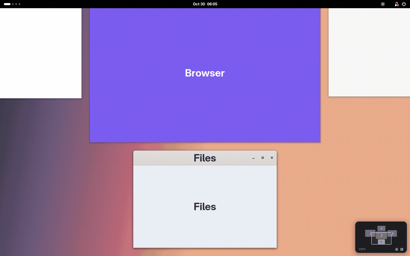
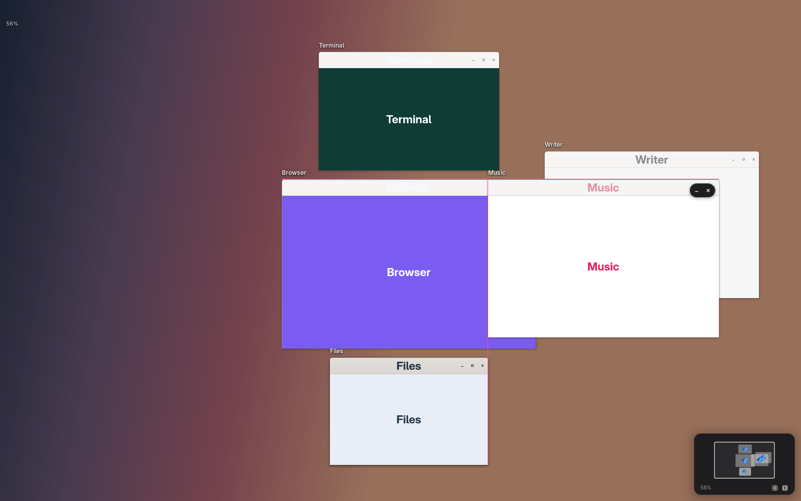

# Skylight

[Sunlight](https://github.com/spacefarm-digital/sunlight) for GNOME: every window on one infinite
canvas. Zoom out to see all of it. Click a window and you're in it, for real, at 1:1.

Windows keep their real size on an endless canvas and your screen is a camera looking at it. Zooming
never resizes anything, so nothing reflows. At 1:1 it is simply your GNOME desktop: real windows,
fully interactive.

Behaviour follows Sunlight's [design notes](https://github.com/spacefarm-digital/sunlight/blob/main/docs/how-it-works.md):
the camera path and spring, the alignment guides and drop grid, edge resizing, Move & Resize, Tidy and
new-window placement are ports of its pure Swift modules (MIT, see `LICENSE-sunlight`). Snapping groups
come from [driftwm](https://github.com/malbiruk/driftwm), and the alternative Tidy style from
[Mosaic](https://github.com/DEM0NAssissan7/mosaic).





## Getting around

| To | Trackpad / mouse | Keys |
|---|---|---|
| Zoom | pinch (two fingers on the desktop or canvas, three anywhere) | `Super` + scroll, anywhere |
| Pan | four-finger swipe anywhere, over windows too; two-finger scroll or drag on the empty desktop or canvas | arrows on the canvas |
| See everything, and back in | three-finger swipe up (down to go back), four-finger tap, Activities, the hot corner | `Super`, `Super`+`Z` |
| App grid | three-finger swipe up again, or the grid button in the canvas's dash | |
| Open an app here | double-click the empty canvas or desktop, or right-click › Open Here…, or just start typing on the canvas | `Super`+`Return` |
| Go into a window | click it (it grows to 1:1 around the click), or pinch in over it | |
| Bring a window to the middle and go in | double-click it | `Return` over it |
| Move a window | drag it: edges and centres line up with neighbours (pink guides), then it settles onto the grid. `Ctrl` moves freely, `Shift` takes its snapped group | |
| Resize a window | drag its edge or corner on the canvas | |
| Minimise / close | hover it: the pill at its top right | |
| Move & Resize | right-click › Move & Resize | halves `Super`+`Ctrl`+arrows (again: ⅔, then ⅓), quarters `Ctrl`+`Alt`+`U` `I` `J` `K`, thirds `D` `F` `G`, two-thirds `E` `R`, fill `Return`, centre `C` |
| Find a window or a frame | type on the canvas (or click the search box): matches stand out, ↑ ↓ to pick, `Return` to go in; with nothing found, `Return` searches apps | |
| Frames: named areas | right-click › New Frame (around the windows in view); drag its name to move it with its windows, its edge to resize it, double-click the name to go there; right-click the name to rename or delete | |
| Strip mode: one row, a column per app | right-click › Strip Mode, the top bar menu, or Settings | `Ctrl`+`Alt`+`S`; `Super`+`,` `Super`+`.` the next column, `Super`+`Alt`+`↑` `↓` within one |
| Tidy everything | right-click › Tidy (on the strip: sort it again) | `Ctrl`+`Alt`+`A` |
| One workspace (on by default): every window on one canvas | top bar menu › One Workspace, or Settings | |
| Undo a move, resize, tidy or layout | right-click › Undo | `Ctrl`+`Z` on the canvas |
| Save / restore a layout | top bar menu, right-click | `Ctrl`+`S` / `Ctrl`+`1`–`9` on the canvas |
| Minimap | click to look there, drag the outline to pan, Fit and 1:1 buttons; a dashed outline is a minimised window: click it to bring it back and go in | |

Everything else is in the sun icon in the top bar, and in Settings (`gnome-extensions prefs skylight@hazard7546`).

### What's the same as Sunlight

- Entering a window keeps the clicked spot under the pointer and the title bar below the top bar; a
  double-click brings it to the middle instead. Pinching in to 90% over a window enters it.
- Flights between places follow van Wijk and Nuij's pan-and-zoom path on an under-damped spring; pans
  and pinches coast after your fingers lift.
- The backdrop is your wallpaper, sharp at 100% and blurring and dimming to 50% (or a dot grid or a
  colour, in Settings).
- **Open Here…** opens GNOME's own search (apps, files, settings…), and the app you open from it
  opens on the spot you picked; on the canvas the camera moves there first. Or, in Settings, Skylight's
  own app bar instead (faster, with a ring on the spot): type to filter (`vsc` finds Visual Studio Code, keywords
  count too), `↑` `↓` to pick, `Return` to open the app's window on the spot you picked (a ring marks
  it), `Ctrl`+`Return` to open it and go in. Apps you open often come first. An app that is running and
  can't open another window brings its last one over instead.
- New windows open in the middle of what you're looking at if that's free, otherwise in the nearest free
  spot beside the windows in the way; on the canvas they pop in with a ripple. At 1:1 the camera never
  moves for a launch: with no free room fully on screen the window opens over the others, as in GNOME.
- **One Workspace** (on by default) turns GNOME's workspaces off and gathers every window onto one
  canvas, each workspace's windows side by side as they were arranged, so the canvas and the GNOME
  overview both show everything. Your workspace settings are kept and come back when you turn it off
  (or turn Skylight off).
- Follow focus moves the camera only for a window that is really out of view: one whose top is on
  screen and that mostly shows stays put, so switching between big windows never swings the camera.
- Picking a window in the GNOME overview moves the camera before the overview closes, so it closes
  straight onto the window.
- Minimised windows keep their place: they leave the canvas and show dashed in the minimap.
- The minimap at 1:1 sits under your windows, so it shows wherever the desktop does.
- The canvas is remembered: after logging in again windows that reopen within two minutes go back to
  their spots. Layouts keep sizes too, and reopen apps that aren't running.

### What's different

- The canvas stands in for GNOME's overview: everything that showed the overview (`Super`, Activities,
  the hot corner, three fingers up) shows the canvas, under the top bar, which stays in use, with a
  search box at the top and GNOME's own dash at the bottom (borrowed from the overview while the canvas
  shows, so its menus, pinning and dragging all work). Clicking an app in it, Alt+Tab or a notification
  goes into the window it activates. GNOME's overview is left
  for search and the app grid. One switch in Settings turns this off.
- Sideways three-finger swipes stay GNOME's (workspaces); four fingers are Skylight's:
  a swipe pans from anywhere, as Sunlight's four-finger drag does, and a tap shows everything. On GNOME 51,
  which takes swipes of three fingers or more, Skylight takes four-finger ones first (an event filter).
- `Esc` on the canvas goes back into the window you came from (on the Mac it does nothing).
- The shortcuts avoid GNOME's own: `Ctrl`+`Alt`+arrows switch workspaces in GNOME, so halves are
  `Super`+`Ctrl`+arrows, and right two-thirds is `Ctrl`+`Alt`+`R` (`T` opens a terminal on Ubuntu).
- No desktop files, widgets, takeover mode or magnetic polarity. Strip mode doesn't reorder the strip
  when you come back to the canvas, only when a window opens or you drag one.

## About this code and extensions.gnome.org

Skylight was written with AI. EGO's review guidelines say
[extensions must not be AI-generated](https://gjs.guide/extensions/review-guidelines/review-guidelines.html#extensions-must-not-be-ai-generated):
whoever submits an extension has to be able to explain and maintain its code. So every source file
starts with the notice the EGO team
[asks AI tools to add](https://blogs.gnome.org/jrahmatzadeh/2026/07/27/ego-ai-reference/):

```js
// Generated with AI for personal use.
// Do NOT upload to extensions.gnome.org (EGO) unless you understand JavaScript
// and can maintain this code.
```

Install it locally as below. Only remove those lines and submit it if you have read the code, can
answer a reviewer's questions about it, and will maintain it. The code follows the EGO
[best practices](https://gitlab.gnome.org/World/javascript/gjs-guide/-/raw/main/docs/extensions/review-guidelines/best-practices.md)
(no defensive try/catch, no lifecycle flags, small entry point, modules with one job each,
`enable()` next to `disable()`, timeouts removed next to where they're created). The one exception to
"target a single GNOME version" is `lib/compat.js`, which keeps the 50–51 differences in one place. EGO
also wants the uuid's namespace to be a domain or account you control (for example
`skylight@yourname.github.io`), so change `uuid` in `metadata.json` and the Makefile first.

## Install

```sh
make install          # copies to ~/.local/share/gnome-shell/extensions
```

Log out and back in, then `gnome-extensions enable skylight@hazard7546`. `make pack` builds
`skylight@hazard7546.shell-extension.zip` for `gnome-extensions install`.

Supports GNOME Shell 50 and 51, on Wayland. Tested end to end on 51.1 (Arch Linux).

## How it works

- **Canvas mode.** Zoomed out, a full-screen overlay (`lib/canvasView.js`) draws every window as a
  `Clutter.Clone` scaled by the camera, over the backdrop (`lib/backdrop.js`): the wallpaper with a blur
  effect, or a dot grid drawn in a fragment shader (`lib/dotGrid.js`).
- **Live mode.** At 1:1 the overlay fades away and each real window sits at `canvas − camera`, moved to
  the same pixel its clone was on, so the hand-over is invisible.
- **Parking.** Mutter keeps at least 10–75 px of every window on screen, so windows the camera can't see
  are minimised without animation, and restored when the camera comes back.
- **GNOME versions.** `lib/compat.js` covers cursors (`Clutter.CursorType` in 51, `Meta.Cursor` in 50); the
  dot grid uses `Clutter.ShaderEffect` on 51, where `Shell.GLSLEffect` is gone.
- **Input** (`lib/input.js`), **persistence** (`lib/store.js`), the **right-click menu**
  (`lib/canvasMenu.js`), **Open Here…** (`lib/launcher.js`), **One Workspace** (`lib/oneWorkspace.js`),
  the **overview swap** (`lib/overviewSwap.js`) and **frames** (`lib/frames.js`) are separate modules, each
  cleaning up its own timeouts and signals.
- **Geometry** (`lib/geometry.js`), **strip mode**'s layout (`lib/strip.js`, after Sunlight's `Strip.swift`)
  and **matching** for search (`lib/appMatch.js`) are pure JavaScript with unit tests: `make test`.

## Limitations

- Only the primary monitor is a canvas; windows on other monitors are left alone.
- Built for Wayland (GNOME 50 and 51 have no X11 session); X11 apps run through Xwayland as usual.
- Mutter won't move a maximised window. Going into one you haven't moved keeps it maximised (the camera
  lines up with it); once the canvas has it somewhere else (you moved it, Tidy did, or the camera went
  on), it becomes a plain window of the same size, so it never hides and going into it never jumps.
- Fullscreen windows are left where they are.
- Layouts can reopen an app's window, but not a particular document or tab.
